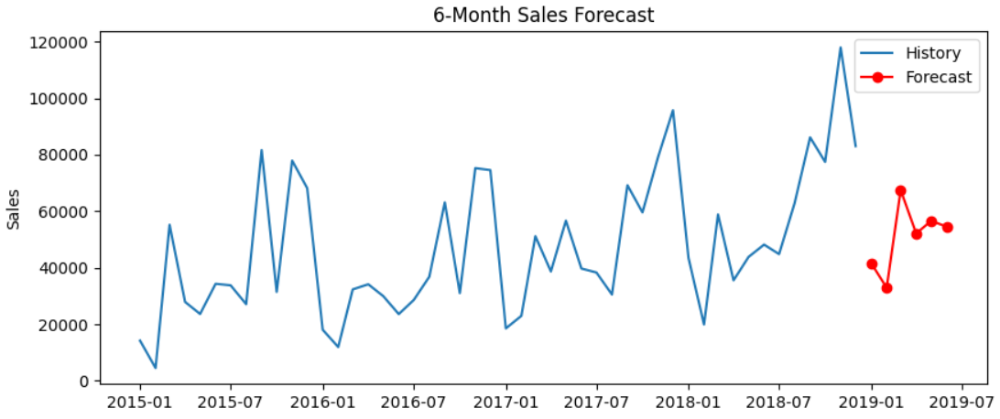
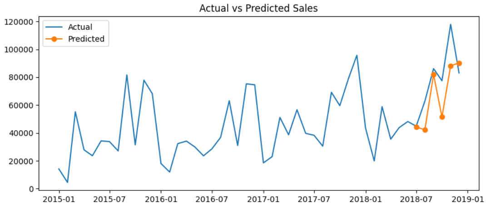

# Sales Forecasting (Predictive Analytics)

## Objective
Forecast future monthly sales from historical data.

## Dataset
Superstore Sales dataset (9,800 orders, 48 months from 2015 to 2018).

## Tools
Python, pandas, scikit-learn, matplotlib, Google Colab

## Method
1. Cleaned the data and aggregated it to monthly sales
2. Created features: time trend and month of year (seasonality)
3. Split by time: first 42 months to train, last 6 to test
4. Trained a Linear Regression model and compared it with a baseline
5. Forecast the next 6 months

## Results
- Model MAE: [your number]
- Baseline MAE: [your number]
- MAPE: [your number]%

## Actual vs Predicted

## Insights
- Sales trend upward, with peaks in November and December.
- Plan inventory and promotions ahead of the seasonal peak.

## Files
- Sales_Forecasting.ipynb: full notebook
- sales_working.csv: dataset
